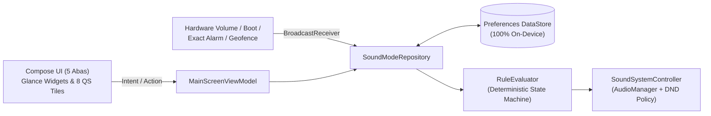

# Modos de Som (Manage Sound Mode) — Android Native App

[](https://github.com/martwilldev/manage-sound-app/actions/workflows/android-ci-cd.yml)

-3DDC84?logo=android&logoColor=white)


> **Modos de Som (`com.managesoundmode.app`)** é um utilitário nativo para Android (API 29 a API 36) de automação inteligente de perfis de áudio, Não Perturbe (`DND`), Timers de Auto-Restauração, Rotinas de Horário e Cercas Geográficas (`Geofencing` + `Wi-Fi SSID`). Projetado com a linguagem visual **Zenith Floating Capsules** (Material 3 Expressive) e operação **100% On-Device** (zero servidores externos, zero telemetria).

---

## ✨ Principais Funcionalidades

* **🎛️ Controle Tátil Instantâneo (`Agora`):**
  * Alternância em 1 toque entre **Som Ativo (`NORMAL`)**, **Vibrar (`VIBRATE`)** e **Silêncio (`SILENT`)** com feedback hático e visual semântico (`Cyan #06B6D4`, `Amber #F59E0B`, `Violet #8B5CF6`).
  * Controle independente dos 4 canais de áudio do Android: **Toque (`STREAM_RING`)**, **Notificações (`STREAM_NOTIFICATION`)**, **Mídia (`STREAM_MUSIC`)** e **Alarme (`STREAM_ALARM`)**, com proteção inteligente contra mídia acidental (*Zero-Media Mute*) e respeito ao aumento manual de volume pelo usuário.
* **⏱️ Timer de Silêncio com Auto-Restauração (`WorkManager` + `AlarmManager`):**
  * Presets rápidos (`15m`, `30m`, `1h`, `2h`) ou duração customizada quando em modo *Vibrar* ou *Silêncio*.
  * Notificação nativa com cronômetro regressivo do sistema (`setUsesChronometer` + `setChronometerCountDown`) e botões de ação direta (`[+30 min]` e `[Restaurar agora]`).
* **🎭 Perfis de Som (Cenas Acústicas):**
  * Perfis prontos (*Casa*, *Trabalho*, *Reunião*, *Sono*) e criação ilimitada de perfis customizados com editor *full-screen* e salvamento automático (*Auto-Save*).
* **📅 Rotinas de Horário (`Schedules`):**
  * Agendamento por dias da semana, janela de início/término (incluindo virada de meia-noite) e flag de **Alta Prioridade** via alarmes exatos (`SCHEDULE_EXACT_ALARM`).
* **📍 Locais & Wi-Fi Híbrido (`Geofencing` + OpenStreetMap):**
  * Seletor visual interativo em mapa **OpenStreetMap** com ajuste de raio (`50m` a `1.000m`) e filtro de busca de redes **Wi-Fi (`SSID`)** para confirmação híbrida de chegada/saída em segundo plano.
* **🧩 Ecossistema de Integrações Android 15/16:**
  * **Widgets de Tela Inicial (`Jetpack Glance 1.1.1`):** Tamanhos `2x1`, `4x1` e `4x2` estilizados como cápsulas *Hero* reativas.
  * **8 Blocos de Configurações Rápidas (`Quick Settings Tiles`):** Tile Principal Ciclista, Tiles Dedicados (*Som*, *Vibrar*, *Silêncio*), *Timer 30m*, *Mute de Mídia*, *Seletor de Perfil* e *Pausa de Automação*.
  * **Barra Rápida Persistente (`Notification Header Gadget`):** Controle silencioso na gaveta de notificações para troca de modo em 1 toque sem abrir o app.
  * **Regras Zen Nativas (`AutomaticZenRule`):** Integração com os *Modos* nativos do Android 15+.
  * **Controle de Acesso Interno (`RBAC` + `PIN Lock`):** Perfis *Admin*, *Padrão* e *Somente Rápido* (proteção contra alterações acidentais).
  * **Bilíngue Nivo (`PT-BR` / `EN-US`):** Internacionalização reativa em tempo real.

---

## 🏗️ Arquitetura e Motor de Regras (`RuleEvaluator`)

O projeto segue **Clean Architecture pragmática** com **Unidirectional Data Flow (UDF)**, separando estritamente a camada de UI (`Compose`), Estado/Domínio (`ViewModel` + `RuleEvaluator` puro em Kotlin) e Infraestrutura do Sistema (`AudioManager`, `NotificationManager`, `DataStore`, `AlarmManager`, `WorkManager`).



### Hierarquia Determinística de Conflitos (`RuleEvaluator`)
1. **Sessão de Timer Manual Ativa (`TimedModeSession`)** — Precedência máxima.
2. **Regra Automática com `isHighPriority = true`** — Ex.: *Reunião Crítica* sobrepõe *Horário Comercial*.
3. **Regra Mais Restritiva (`SILENT > VIBRATE > NORMAL`)** — Nunca toca alto durante sobreposição de regras.
4. **Override Manual do Usuário (`overriddenSessionKey` + janela de `1.500ms` para botões físicos de volume)** — Respeita ajustes manuais até o fim da janela atual.
5. **Política de Restauração (`RestorePolicy`)** — Restaura o `Snapshot` anterior ou o `Perfil Padrão` configurado.

---

## 🛠️ Stack Tecnológica

| Camada | Tecnologia | Versão |
| :--- | :--- | :--- |
| **Linguagem** | Kotlin (JVM Toolchain 17) | `2.3.20` |
| **Build System** | Android Gradle Plugin (AGP) + R8 Shrinking | `9.0.1` |
| **Target / Min SDK** | `compileSdk = 36` / `targetSdk = 36` / `minSdk = 29` | Android 10 – 16 |
| **UI Toolkit** | Jetpack Compose BOM + Material 3 Expressive (*Zenith*) | `2026.03.01` |
| **Navegação** | Jetpack Navigation 3 (`NavKey` tipado + Kotlinx Serialization) | `1.0.1` |
| **Widgets** | Jetpack Glance (`GlanceAppWidget` + Material 3) | `1.1.1` |
| **Persistência** | Jetpack Preferences DataStore + Kotlin Coroutines/Flow | `1.1.3` |
| **Background** | WorkManager + `AlarmManager` + `BroadcastReceiver` | `2.10.0` |
| **Testes** | JUnit 4, Coroutines Test, Turbine, Compose UI Test / Espresso | `100% Green` |
| **CI/CD** | GitHub Actions & GitLab CI + Google Play Developer API v3 | Automatizado |

---

## 🚀 Como Executar e Testar Localmente

### Pré-requisitos
* **JDK 17+** e **Android SDK (API 36)** configurados.

```bash
# 1. Rodar a suíte de Testes Unitários (RuleEvaluator, ViewModel, RBAC, Geofence, RestorePolicy)
./gradlew testDebugUnitTest

# 2. Executar análise estática do Android Lint
./gradlew lintRelease

# 3. Gerar APK de Debug para instalação local
./gradlew assembleDebug
```

---

## 🛡️ Segurança, Privacidade e Governança

* **Política de Privacidade:** Consulte [`docs/PRIVACY_POLICY.md`](./docs/PRIVACY_POLICY.md) ou acesse a [página pública oficial](https://matheusmaia.gitlab.io/manage-sound-mode-privacy/).
* **Política de Segurança:** Consulte [`SECURITY.md`](./SECURITY.md) para diretrizes de proteção e reporte privado de vulnerabilidades.
* **Licença:** Repositório público de portfólio sob licença *Source-Available* — veja [`LICENSE`](./LICENSE).
